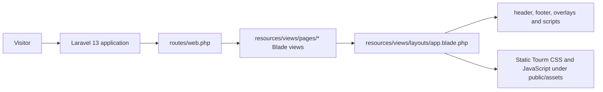

# Architecture

## Status

This document describes the observed Laravel scaffold and accepted Laravel-first direction. Selected Tourm public pages and static policy pages are now served from Blade; enquiry handling and Filament administration are not implemented.

## Current application shape

The application is a single Laravel project. The current web request path is:

`routes/web.php` maps `/` and clean page paths to named Blade views. Previous `.html` URLs for implemented pages permanently redirect to clean paths; `/error` and unmatched paths return the shared Tourm error view with HTTP 404. `layouts/app.blade.php` includes shared overlay, header, footer and script partials, and loads Bootstrap/Tourm CSS and JavaScript directly from `public/assets/`. The original Laravel welcome view and Vite/Tailwind setup remain in the repository but are not loaded by these pages.

There is no `routes/api.php`, separate frontend application, travel-domain controller/model, authentication flow, Filament panel, or deployment target in the audited repository. The copied Tourm source pages retain demo search, contact, newsletter, and account forms; these are not connected to Laravel and some still reference the external template endpoint.

## Application boundaries

- **Public website — current:** Selected Tourm pages (Home Travel Agency, About, Services/detail, Activities/detail, Destinations/detail, Tours/detail, FAQ, Contact, Blog/detail, Gallery, Error) and static Terms, Privacy, Cookies views use the shared Blade shell. The home header remains layout8, inner pages use layout1, and desktop/mobile share the same navigation partial. The Home and Pages dropdowns were removed; Destination, Service, Activities, and Blog detail submenus remain. A&PM logos are integrated; Tourm demo copy, links, prices, testimonials, contact details, and external form actions remain pending a later approved content pass. Browser comparison is outstanding.
- **Public website — planned:** Content approval/replacement, functional cookie consent choices if needed, and a Laravel enquiry workflow.
- **Business workflows — planned:** Enquiries and quotations handled in the same Laravel application through validated routes, domain models, authorization, and staff follow-up.
- **Administration — planned:** Filament is proposed but absent. If adopted, keep the panel within this Laravel app and protect every resource/action with authentication and authorization.
- **Assets — current:** The converted public pages load copied Bootstrap/Tourm CSS, JavaScript, fonts, and images from `public/assets/`. The Laravel Vite/Tailwind entry points remain available but are not loaded by these page layouts.

## Data flow

There is no A&PM business data flow today. The starter `User` model and Laravel infrastructure migrations support framework defaults only. Source-faithful pages retain Tourm template forms whose actions may point to the original external demo `mail.php`, `#`, or no endpoint; they are not Laravel enquiry endpoints and do not persist to this application's business database. The active database driver is **Not yet verified**; see [Database](DATABASE.md).

Planned enquiry flow: browser form → Laravel web route → Form Request validation and rate limit → authorized application workflow/model → staff follow-up and quotation. Do not create an automatic reservation, inventory hold, ticket, or payment as a side effect of enquiry submission.

## Architecture decisions

- [ADR 0001 — Laravel-first monolithic application](decisions/0001-laravel-monolith.md) records the established decision to continue with one Laravel application rather than introducing separate backend/frontend deployments.
- Bootstrap is required by the selected Tourm template direction, while the Laravel scaffold still declares Tailwind. The landing page currently isolates Tailwind by not loading its Vite entry; the framework strategy for future pages remains open. See [Frontend](FRONTEND.md).
- No API contract, role/permission package, queue backend, content-management approach, or production database has been selected for A&PM-specific functionality.

## Change rules

Prefer Laravel conventions and keep public presentation, request handling, persistence, and authorization in their appropriate layers. Add a separate service/action only when an approved workflow has enough complexity to justify it. Record material architecture changes in a new ADR and update the implementation roadmap.

## Contact enquiry workflow — 2026-11-09

The approved email-only first release adds POST `/contact` (`contact.send`) through ContactEnquiryController and SendContactEnquiryRequest. The GET page remains a Blade view. Validation, CSRF, an empty honeypot and a named 5-per-minute/IP limiter protect submission. A synchronous ContactEnquiry mailable uses SMTP explicitly, a configured A&PM From address, fixed configured staff recipients and visitor Reply-To. Success/failure uses redirects with session feedback; throttle responses render Contact with HTTP 429 and Retry-After. No travel-domain persistence, queue, admin or automatic customer email is implemented.

Private recipient configuration is mandatory; missing/invalid recipients fail closed. Transport errors preserve form input and log only a generic diagnostic plus exception class. SMTP acceptance is not verified inbox delivery. See CONTACT-FORM-PLAN.md for the approved email-only tradeoffs, configuration and remaining live verification. This supersedes earlier descriptions of Contact as an external demo or contact-links-only page; other copied demo forms remain unimplemented.

### Visitor acknowledgement update — 2026-11-09

ContactEnquiryController now sends a separate ContactAcknowledgement to the validated visitor after the staff notification succeeds. It uses fixed HTML/plain-text content and A&PM Reply-To, without quoting visitor input. Acknowledgement transport failure preserves staff-submission success and adds a separate visitor notice. This supersedes earlier statements that no customer email is sent. No queue or persistence was added.
