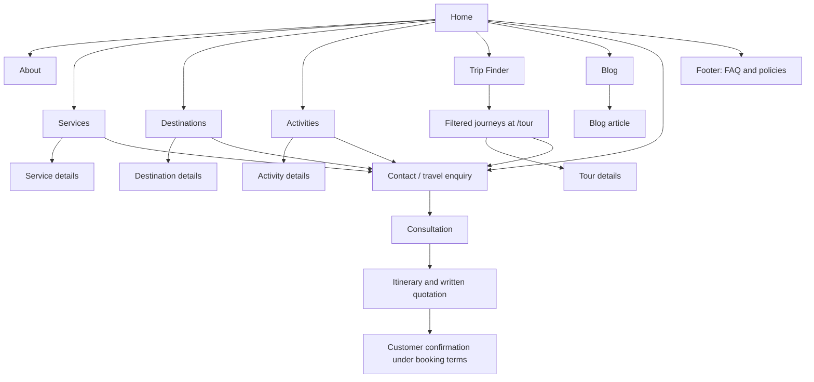

# Landing Page Design Plan

**Status:** A first A&PM content pass is implemented for selected homepage sections. The Trip Finder form remains the copied demo form; its adjacent carousel now displays 10 Company Profile destinations with extracted profile images. This is still a working plan: copy, reused imagery, browser behavior, and production approval remain to be reviewed. The plan is based on the supplied A&PM Company Profile v1 and Website FAQs v0, the current converted homepage, and the local Tourm demo files.

## Goal

Use the homepage to explain what A&PM does, help visitors search approved published journeys, and lead them from matching results to an enquiry and written quotation. Search is an important discovery feature; it does not mean live inventory, confirmed availability, instant booking, or payment.

The primary browsing path should be **Trip Finder → matching journeys → journey details**. The next action should be **Request a tailored quote → Contact**. Destination, service, activity, blog, and FAQ pages support that decision.

## Business information the profile supports

The supplied Company Profile describes A&PM Tours Ltd, branded as A&PM Tours & Travel Ltd, as a Kenya and East Africa travel agency that also supports travel beyond the region. Its services include:

- Safaris, holidays, weekend escapes and tailor-made experiences.
- Hotel, lodge, camp and resort reservations.
- Private and group transport, airport transfers and guide coordination.
- Domestic and international flight ticketing and travel reservations.
- Destination management, corporate travel, conference travel and group movements.

The profile highlights Maasai Mara, Amboseli, Naivasha, Lake Nakuru, Samburu, Mount Kenya, Tsavo East and West, Nairobi, the Kenya Coast, and East African itineraries. It identifies leisure travellers, couples and families, diaspora travellers, groups, educational and special-interest travellers, corporate clients, and international travel agents/operators as audiences.

The seven-stage operating flow supplied from the Company Profile is:

1. **Enquiry & Consultation:** understand travel dates, party size, interests, budget and preferred travel style.
2. **Itinerary Design:** create a practical itinerary with suitable destinations, pacing and inclusions.
3. **Quotation & Confirmation:** issue the package price, booking terms and payment schedule; reservations follow customer confirmation under those terms.
4. **Supplier Reservations:** reserve accommodation, licensed transport, guides and required activities.
5. **Pre-Travel Support:** share confirmations, trip information, packing guidance and contact details.
6. **Journey Delivery:** coordinate the trip, monitor service delivery and remain available for support.
7. **Post-Trip Follow-Up:** close supplier accounts, collect feedback, and support referrals and repeat business.

An enquiry or unconfirmed quotation is not a booking. Availability and final pricing require confirmation. Keep that distinction clear on the homepage and its calls to action.

## What the Tourm demos offer

### `index.html`

This is a general travel-tour homepage with a `header-layout1` / `footer-layout1` shell. Its section patterns include a large hero, tour categories, popular destinations, trip-planning promotion, tour cards, gallery/statistics, guide profiles, testimonials and articles. The section order is useful for studying visitor flow, but its prices, destinations, performance figures, guide profiles, reviews and article content are Tourm demo data.

### `home-travel-agency.html` — current selected base

This is already the Laravel homepage and uses the distinctive `header-layout8` / `footer-layout2` combination. It includes a hero carousel and search/booking form, categories, destinations, package cards, gallery, guide profiles, a feature section, testimonials and articles. It is the strongest visual starting point for the agency site already in this repository.

### Other useful comparisons

- `home-agency.html` emphasizes destination inventory, travel categories and experience cards. Its “850+ Destinations” metric is unsupported for A&PM and should not be reused.
- `home-tour.html` emphasizes tours, offers, discounts and booking. That structure suits a package catalogue more than A&PM's current quotation-led process.

**Design recommendation:** Keep the selected Home Travel Agency layout and its existing Bootstrap/Tourm styling. Use `index.html` and the other demos as references for section patterns only. Do not copy their demo claims, prices, forms, people, reviews, statistics or brand marks.

## How to reuse the pictured Tourm section

The screenshot shows two connected pieces from `resources/views/pages/home.blade.php`: the `booking-sec` filter form (Destination, Type, Duration, Search) and the `package-area` card carousel beneath it. The form still posts to Tourm’s external demo `mail.php` and is not a working search. The carousel has been repurposed to show the ten destinations and images supplied in Company Profile v1; demo package prices and “Book Now” links are gone.

For the A&PM landing page, preserve the responsive filter-panel and carousel styling as a visual starting point, then connect them to a real published-journey catalogue:

- Keep **Destination**, **Type of journey**, and **Duration** as genuine filters, but make each filter match data that A&PM has approved and published. Add a travel-month filter only if seasonal content is maintained.
- Submit search criteria to the Laravel tours/results page (`/tour` is the current route) as a shareable GET search. Do not send search to Tourm's external `mail.php` or make users submit personal details just to see results.
- Use the carousel for approved journeys and/or destinations. Result cards should say what the journey is, where it goes, how long it takes, and whether pricing is approved or quotation-led.
- Remove demo country names, descriptions, prices, and **Book Now** links. Use **View journey** for details and **Request a quote** for `/contact`, carrying the selected journey into the enquiry.
- Show filter state, a result count, a clear-filters action, and a helpful no-results path to a custom trip enquiry. Do not present the results as live availability.
- The screenshot shows the sticky navigation over the section while scrolled. Check it at actual scroll positions; if it obscures the heading or cards, adjust the sticky spacing in the shared header without changing the Tourm section structure unnecessarily.

The recommended search/results flow is detailed in [Search and Trip Finder Research](SEARCH-AND-TRIP-FINDER-RESEARCH.md). The Trip Finder form remains a demo and needs an approved searchable catalogue and Laravel GET behavior. Its adjacent carousel is a destination showcase, not search results or live inventory.

## A&PM color direction

The user has directed the branding to follow the approved A&PM logo and company-document context. The Company Profile supports a modern, professional, flexible, dependable, customer-focused tone. Although there is no formal brand palette guide, recurring heading/accent colors are present in the supplied Terms, Cookies, and Privacy documents, and the logo uses the same forest-green/gold family.

| Role | Working value | Basis and use |
| --- | --- | --- |
| Forest green | `#0B5A3C` | Repeated policy-document heading color; consistent with the dark green sampled from the logo. |
| Gold | `#C8942D` | Privacy-document accent color; the related policy documents use nearby variants `#C7902B` and `#C9932B`. |
| Sunset amber | `#F69F28` | Median sampled from the sun/bright amber artwork; decorative highlight or background with a dark foreground. |
| Warm neutral | `#F8F5EC` | Proposed surface color to complement the logo; not specified by the company documents. |
| Dark text | `#26342B` | Proposed neutral text color; verify contrast in context. |

These are normalized working values, not a formally published brand guide: the logo uses gradients and the policy documents contain small color variations. Keep small text and important controls contrast-safe; do not use gold or bright amber as small text on white. The values are now applied through `public/assets/css/apm-brand.css`, loaded after Tourm's `style.css`; the copied source CSS and page markup remain unchanged. **Browser-level visual and responsive verification is still pending.**

## Recommended homepage content order

| Order | Section | Visitor question answered | Proposed content and next step |
| --- | --- | --- | --- |
| 1 | Hero | “Can this agency help with my trip?” | State that A&PM plans and coordinates travel in Kenya, East Africa and beyond. Primary CTA: **Start planning** → `/contact`. Secondary CTA: **Explore destinations** → `/destination`. Use one primary H1 and avoid repeated carousel H1s. |
| 2 | Trip Finder and destination cards | “Which journeys match my destination, style, and time?” | The form is still a demo and must become approved GET filters before it is described as search. Its adjacent carousel displays the 10 Company Profile destinations and extracted images; it does not show package prices or live availability. **Find journeys** → filtered results at `/tour` after catalogue approval. |
| 3 | Short introduction | “Who is A&PM?” | A concise version of the Company Profile's identity and service promise, with **About A&PM** → `/about`. |
| 4 | Service overview | “What can you arrange?” | Group the service catalogue into a small number of scannable cards (for example: Safaris & Holidays; Travel Services; Groups & Corporate; Tailor-Made Experiences). Link **All services** → `/service`; use `/service-details` only after its copied demo content is replaced. |
| 5 | How We Deliver | “How does A&PM manage a trip from enquiry through follow-up?” | Use the `blog-grid4-static` layout from `home-hiking.html` for the seven Company Profile stages: consultation, itinerary design, quotation and confirmation, supplier reservations, pre-travel support, journey delivery, and post-trip follow-up. Link **Tell us about your trip** → `/contact`. |
| 6 | Why Choose A&PM | “Why plan with A&PM?” | Follow the delivery process with five profile-supported points: personalised planning, one point of contact, clear inclusions, responsive communication and supplier coordination. |
| 7 | Separate destination section (deferred) | “Where can I go?” | The standalone destination section after Services remains omitted at the owner’s direction. The carousel below Trip Finder now provides the profile-based highlights; `/destination` remains accessible. |
| 8 | Activities / experiences | “What kind of trip can I plan?” | Optional teaser for cultural, nature, adventure, honeymoon, educational and photography-focused experiences. Link **Explore activities** → `/activities` after that page has approved A&PM content. |
| 9 | Editorial preview | “Can I learn more?” | Optional. Add only when A&PM has approved articles and images; then link **Read more** → `/blog`. Do not feature the current Tourm demo posts. |
| 10 | Final enquiry callout | “How do I take the next step?” | Repeat a clear consultation/quotation CTA and approved phone, email and WhatsApp details from the Company Profile. Link to `/contact`. |
| 11 | Footer | “Where are policies and quick links?” | Keep FAQs, Terms & Conditions, Privacy Policy and Cookies Policy in the footer, alongside the other approved site links. |

The section count can be reduced during design. A shorter homepage with a clear enquiry path is preferable to keeping every Tourm demo block.

## Navigation and page flow

The current Laravel routes use clean paths such as `/service`, `/destination`, and `/blog-details`; use named routes for page navigation. Previous `.html` URLs redirect to these paths. The future search should lead to filtered results at `/tour`; quotation CTAs should lead to `/contact`. Do not send search criteria to the external demo form or invent payment/instant-booking endpoints.

## Homepage content to remove or replace during the design pass

The Trip Finder form remains Tourm demo material and must not be presented as working search. Its carousel now shows profile destinations rather than offers. Other Tourm-only homepage modules were removed during the first content pass. Do not present remaining template material on other pages as A&PM facts:

- The Trip Finder’s external Tourm `mail.php` action and sample filter choices remain. Replace them only when an approved catalogue and real Laravel search/results behavior are ready; keep the adjacent destination carousel distinct from searchable journey results.
- Tourm demo destinations, package prices, discounts, ratings, or availability on any page.
- Statistics such as visitor counts or destination totals.
- Tourm guide names/photos, testimonials, customer ratings, demo blog articles, and brand marks.
- Claims such as “24/7 support”, instant itinerary generation, or exclusive deals unless A&PM separately confirms them.
- The Activities teaser is deferred until its destination page has approved A&PM content; the Blog preview is omitted until approved articles and images exist.

Use the same page sections and styling only where they present approved Company Profile facts. Do not fill empty cards with fictional packages or invented reviews.

## Proposed implementation approach

1. Keep `resources/views/pages/home.blade.php` as the only homepage body and keep its existing shared layout/header/footer.
2. Preserve Tourm’s Trip Finder panel and carousel styling. Keep the destination carousel as profile-backed destination highlights; implement searchable journey results separately after the catalogue and filters are approved.
3. Implement search as a Laravel GET search to `/tour` with query parameters, result count, active filters, reset behavior, and an empty state. Do this only after the searchable catalogue records and their maintenance owner are approved.
4. Link result cards to journey details; pass the selected journey to the Contact/quote flow. Keep search and quotation as separate steps.
5. Use approved profile facts for services, destinations and the consultation process. Keep policy links in the footer.
6. Apply the logo-derived color direction through a separate stylesheet, then compare the page to the supplied Tourm source at mobile, tablet and desktop widths. Preserve Tourm markup, Bootstrap behavior, and plugin dependencies.

## Decisions to confirm before coding the design

1. Approve the Trip Finder and results flow; choose the first searchable journeys and whether the catalogue includes only tours or other services.
2. Confirm destination/type/duration filter values, whether travel month is useful, and whether any pricing may be displayed.
3. Review the current service cards and decide whether to restore destination highlights to the homepage in a later content pass.
4. Confirm whether Activities and Blog should have a homepage preview in the first branded pass. Their pages currently contain Tourm demo content.
5. Approve hero headline and CTA labels, using the Company Profile promise without implying instant booking.
6. Confirm the supplied contact details and policy drafts are ready for public display.

The homepage’s initial A&PM copy and selected section reuse are in place, but this is not a production-complete or owner-approved page. Search implementation, approved activity/article content, and visual review remain outstanding.
